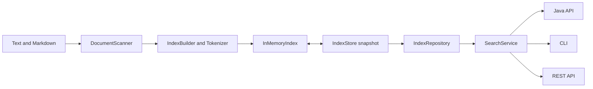

# Architecture

MiniSearch has no external runtime libraries. JDK APIs provide filesystem access,
binary I/O, Unicode normalization, and the HTTP server. JUnit is a test dependency.

## Responsibilities

| Package | Responsibility |
| --- | --- |
| `source` | Read bounded UTF-8 files, skip symbolic links, and validate portable relative paths |
| `text` | Normalize searchable words and map normalized matches back to source offsets |
| `index` | Build immutable documents/postings, refresh changed content, and persist snapshots |
| `search` | Parse query expressions, evaluate matches, rank results, and produce snippets |
| `cli` | Validate command options, load snapshots, and format terminal output |
| `http` | Decode request parameters, serialize JSON, and serve the current saved snapshot |

## Index construction

The scanner sorts paths relative to the source root. The tokenizer splits Unicode
words, applies NFKC and lowercase normalization, then splits expansions into
searchable words. Positions count those normalized words. A normalized word that
expands into several words shares the original source span for snippet matching.

The inverted index maps each term to a sorted list of document postings. A posting
contains increasing token positions; its frequency is the position count.
Document lengths are measured in tokens. Original content is retained for snippets.
A sorted term dictionary supports bounded prefix lookup without scanning documents.

Refresh compares source content against the previous snapshot. It retokenizes
added and changed documents, removes deleted documents, and reuses unchanged
postings. It still reads source files to detect changes; filesystem timestamps
are not treated as proof that content is unchanged.

## Search execution

1. Parse terms, phrases, Boolean operators, and global filters into an expression.
2. Expand each prefix into at most 64 concrete indexed terms.
3. Evaluate posting-set intersections, unions, and complements. Phrase candidates
   must also have adjacent positions in the requested order.
4. Collect terms from matching positive branches and sum their BM25 contributions
   in sorted term order. Exclusions do not increase scores.
5. Sort by descending score and then relative path. Apply pagination and build
   snippets only for returned results.

Repeated query terms contribute once. Filters apply globally and do not change
corpus-wide BM25 statistics. Empty and filter-only queries have different
semantics, documented in the [query guide](query-language.md).

## Persistence and concurrency

Snapshots use a versioned binary format with a SHA-256 checksum. Writers serialize
to a temporary sibling file, then atomically replace the destination. A failed
scan or write preserves the prior snapshot. See [storage and recovery](index-format.md).

The HTTP service shares an immutable search view across virtual-thread handlers.
The snapshot provider compares file identity, size, and modification time on
requests and synchronizes replacement loads. A missing or invalid replacement
returns HTTP 503; the service resumes when a valid snapshot is available.

Use one snapshot writer at a time. There is no multi-writer lock, database,
distributed coordination, or authentication layer. The default network binding
is loopback. [Operations](operations.md) describes these deployment boundaries.
